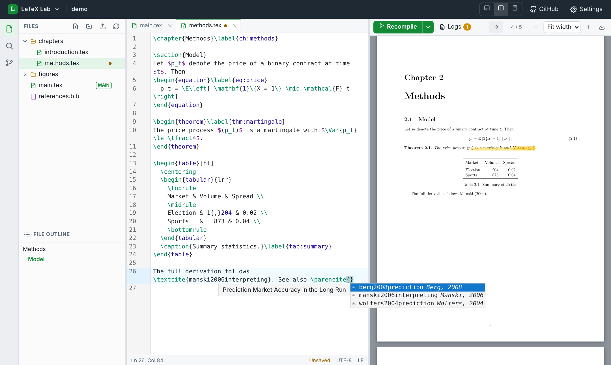

# LaTeX Lab

A local, offline LaTeX editor that works like Overleaf: files on the left, code in the middle, PDF on the right. Press **Ctrl+S** and it compiles.

Your project lives in a normal folder on your computer. GitHub is your backup, and it's also how you move work between LaTeX Lab and Overleaf.



- **Compiles the way Overleaf does.** It runs `latexmk -cd -jobname=output -synctex=1 -interaction=batchmode -f -pdf` in a private build folder, so your project folder never fills up with `.aux` and `.log` files. biber/BibTeX, makeindex, glossaries and nomencl run automatically.
- **Finds your TeX installation for you.** Most broken IDE setups are PATH problems. LaTeX Lab looks in the standard TeX Live, MiKTeX and MacTeX install folders itself. If latexmk can't run (MiKTeX without Perl), it switches to a built-in runner.
- **Overleaf-style errors.** A log pane with errors, warnings and bad boxes. Click one to jump to that line in the right chapter file. Errors also show in the editor gutter, and common errors come with a plain-English hint.
- **SyncTeX both ways.** **Ctrl+Alt+J** (or the → button) shows the cursor's spot in the PDF. Double-click the PDF to jump back to the code.
- **Autocomplete.** `\ref{` / `\cref{` complete your labels, `\cite{` / `\parencite{` your bibliography keys (with author and year), and `\begin{` your environments (with `\end{}` added). `\includegraphics{` and `\input{` complete file paths, `\usepackage{` package names, and your own `\newcommand`s are included too.
- **GitHub sync.** A Git panel with changed files, diffs, Commit, Pull, Push and one-click **Sync with GitHub**. If a pull brings a conflict, the panel walks you through resolving it. Commits work offline; pushing waits until you're online.
- **Plus:** file tree (drag & drop upload and move), file outline, project-wide search, Ctrl+P quick open, dark mode, browser spell check, auto-save, and auto-reload when git changes a file you have open.
- **No internet needed** to edit or compile. The UI is bundled, nothing loads from a CDN, and the server only listens on `127.0.0.1`.

---

## Install on Windows (about 10 minutes plus the TeX download)

**1. Install Python** (if you don't have it). In PowerShell:

```powershell
winget install -e --id Python.Python.3.12
```

**2. Install TeX Live**, the same TeX distribution Overleaf runs, so everything that compiles on Overleaf compiles here.

Download `install-tl-windows.exe` from <https://tug.org/texlive/windows.html>, run it, and click **Install** with the default *full* scheme. It's about 8 GB and takes an hour or two, once. After that, compiling never needs the internet.

> Lighter option: `winget install -e --id MiKTeX.MiKTeX`, then in MiKTeX Console → Settings choose *Always install missing packages on-the-fly*. MiKTeX fetches packages the first time they're used, so it needs internet occasionally.

**3. Install Git** (for GitHub sync):

```powershell
winget install --id Git.Git -e
```

**4. Get LaTeX Lab and start it:**

```powershell
git clone https://github.com/duresh08/latex-local.git
cd latex-local
py -m pip install .
latexlab shortcut      # adds "LaTeX Lab" to your Desktop and Start menu
```

Then double-click **LaTeX Lab** on your Desktop. It opens as its own window in Edge or Chrome.

Without installing, you can also double-click **`LaTeX Lab.bat`** in the folder, or run `py -m latexlab C:\path\to\your\project`.

Check your setup any time with:

```powershell
latexlab doctor
```

---

## Bringing your Overleaf project over

### Option A: Clone from GitHub (if your Overleaf project is linked to a repo)

1. In Overleaf: **Menu → GitHub → Push Overleaf changes to GitHub**. Make sure the repo actually has your files.
2. In LaTeX Lab's start page: **Clone from GitHub**, paste `https://github.com/<you>/<repo>`, then **Clone & open**.

Git uses your normal GitHub sign-in. On Windows, Git Credential Manager opens a browser window the first time.

### Option B: Import the Overleaf .zip (no GitHub link needed)

1. In Overleaf: **Menu → Download → Source** gives you a `.zip`.
2. In LaTeX Lab: **Import an Overleaf .zip**, pick the file, and optionally paste a GitHub repo URL (an **empty** repo is fine).
3. Open the Git panel and press **Sync with GitHub**. Your whole project is now on GitHub.

If you later want Overleaf to see the same repo: in Overleaf, **New Project → Import from GitHub**.

> Overleaf can only *create* a repo from a project, or *import* a repo into a new project. It can't attach an existing project to a repo you made yourself on GitHub. If you created an empty repo by hand, Option B is the way to fill it.

## Daily workflow

```
 Overleaf  ⇄  GitHub  ⇄  LaTeX Lab (your PC, works offline)
```

- Write in LaTeX Lab. **Ctrl+S** saves and compiles. Files also auto-save as you type.
- **Commit** whenever you reach a good point. It's local and instant, even offline.
- When online, press **Sync with GitHub**: it commits, pulls anything new (for example edits made on Overleaf), then pushes.
- In Overleaf, **Menu → GitHub → Pull GitHub changes into Overleaf** shows your local work there. Before syncing locally, use **Push Overleaf changes to GitHub** if you edited on Overleaf.
- If both sides changed the same lines, LaTeX Lab marks the files with conflicts. Keep the text you want, delete the `<<<<<<<` / `=======` / `>>>>>>>` lines, and click **Mark resolved & commit**.

If you lose Overleaf access, nothing changes here: GitHub has the full history and LaTeX Lab compiles everything locally.

## Settings

Open **Settings** in the top bar:

| Setting | Default | Notes |
|---|---|---|
| Main document | auto (`main.tex`, or the file with `\documentclass`) | Right-click any `.tex` in the tree → *Set as main document* |
| Compiler | pdfLaTeX | XeLaTeX / LuaLaTeX for `fontspec` |
| Engine | Automatic | latexmk → built-in runner → Docker → Tectonic |
| Shell escape | on | Overleaf allows it; needed by `minted`, `svg` |
| Timeout | 240 s | Raise for very large documents |

LaTeX Lab keeps its own state (settings, recent projects, build cache) in `%APPDATA%\LaTeXLab` (`~/.latexlab` on macOS/Linux), never inside your project.

## Troubleshooting

- **"No LaTeX installation was found"**: open **Menu → LaTeX setup guide**. If TeX is installed somewhere unusual, paste the folder that contains `pdflatex.exe` (for example `C:\texlive\2025\bin\windows`) under *Installed but not detected?*
- **`File 'something.sty' not found`**: the package isn't installed. A full TeX Live has everything. With a smaller TeX Live, run `tlmgr install something`; with MiKTeX, install it from MiKTeX Console.
- **Odd leftovers after changing packages**: compile menu (▾ next to Recompile) → *Clear cached files & recompile*.
- **Push asks for a password / fails**: run `git push` once in a terminal inside the project folder and finish the GitHub sign-in. After that, LaTeX Lab can push.
- **Docker instead of a local install**: `docker pull texlive/texlive:latest`, then Settings → Engine → Docker. Compiles run with networking disabled.

## Development

```bash
python -m unittest discover -s tests -t .     # backend tests (compile tests run if TeX is installed)
cd frontend && npm install && npm run build   # rebuilds latexlab/static
```

The backend is plain Python 3.9+ standard library, with no dependencies. The UI is vanilla JS with CodeMirror 6 and PDF.js, built with Vite into `latexlab/static/`. The build output is committed, so users never need Node.js.

| File | What it does |
|---|---|
| `latexlab/compiler.py` | Mirrors the project into the build folder, runs latexmk / built-in runner / Docker / Tectonic |
| `latexlab/toolchain.py` | Finds TeX, Perl, git and Docker; picks an engine |
| `latexlab/logparser.py` | TeX/BibTeX/Biber log → errors and warnings with file and line |
| `latexlab/synctex.py` | Reads `.synctex.gz` directly (no `synctex` binary needed) |
| `latexlab/gitops.py` | Git status, commit, pull, push, sync, conflicts, with friendly errors |
| `latexlab/server.py` | Local HTTP API (token- and Host-checked) |
| `frontend/src/` | Editor, PDF viewer, file tree, panels |
